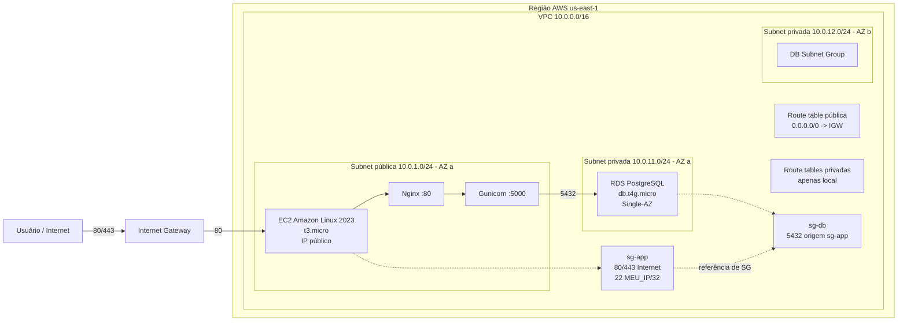

# Arquitetura AWS

## Componentes e decisões

- **VPC e subnets:** `10.0.0.0/16` separa uma subnet pública da camada de dados privada. A EC2 fica em `10.0.1.0/24`, com IP público; o RDS usa o DB Subnet Group com `10.0.11.0/24` e `10.0.12.0/24`.
- **Duas subnets privadas:** o DB Subnet Group exige subnets em AZs distintas para a configuração de rede do RDS e deixa a arquitetura preparada para uma futura implantação Multi-AZ. O RDS desta fase continua Single-AZ.
- **Roteamento:** a route table pública tem `0.0.0.0/0` para o IGW. As privadas têm apenas a rota local. Não há NAT Gateway porque o banco não precisa iniciar conexões para a Internet e a EC2 pública pode instalar seus pacotes diretamente; isso reduz custo recorrente e superfície de saída. Em uma topologia sem EC2 pública, seria necessário outro caminho de saída controlado.
- **Security Groups:** `sg-app` aceita 80/443 de qualquer origem e SSH somente de `<MEU_IP>/32`. `sg-db` aceita 5432 com origem **sg-app**, não com um CIDR amplo. A referência entre SGs acompanha a identidade da camada de aplicação mesmo que seus IPs mudem.
- **Nginx e Gunicorn:** Nginx termina a entrada HTTP, faz proxy e será o ponto de TLS; Gunicorn fica em `127.0.0.1:5000`, sem exposição direta. Isso separa o servidor de borda do servidor WSGI e simplifica a futura habilitação de HTTPS.
- **Persistência:** a aplicação cria a tabela `flags` no RDS através do comando `flask init-db`, conforme o entrypoint original; o bootstrap reproduz a espera por PostgreSQL e essa inicialização.
